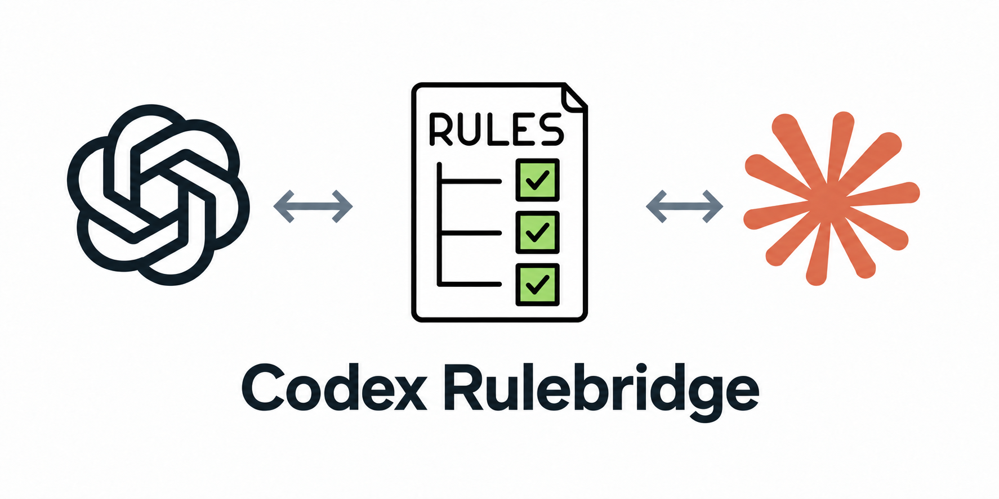

# Codex Rulebridge



**Modular, selectively loaded repository rules for Codex.**

Organize your conventions in `.agents/rules/`. Global rules load at startup;
path-scoped rules load when supported local tools first touch matching files.
Unchanged rules are not reinjected at every prompt.

Works in a Codex-only repository. If teammates use Claude Code, optionally share
the same rules with `.claude/rules/` through bidirectional synchronization.
Rules belong to the repository, not to a particular model.

[Lire en français](REAME_FR.md).

Version 1.0.1 is a CLI with a shell installer, with no npm publication or Codex plugin required.

## Demo

https://github.com/user-attachments/assets/8dc28e7f-2b71-46eb-8207-fea8148f8cc2

[Watch the 48-second demo](assets/demo.mp4). An English illustrated IDE workflow:
organize `.agents/rules/`, run `init`, review hooks, then let a component task load
its frontend rule. Backend guidance stays unloaded. Optional Claude sharing with
`sync` appears at the end.

The IDE, context indicator and Codex response are illustrative. The renderer
verifies the real CLI and simulated hook payloads; real Codex tests are documented
in [live validation](docs/live-validation.md). The walkthrough reflects version 1.0.0.

## Quick start

Requires Node.js 22+, Git, and a Codex version supporting command hooks with
`additionalContext`. Use macOS, Linux, or **Windows through WSL**. Native Windows
installation and hook execution from PowerShell or Command Prompt are not supported yet.

Install with one command:

```sh
curl -fsSL https://raw.githubusercontent.com/Effeilo/codex-rulebridge/main/install.sh | bash
```

The installer requires Bash, Node.js 22+ and Git (`curl` for the one-line download).
It installs the CLI under `~/.local/share/codex-rulebridge`, links the command into
`~/.local/bin`, and adds a marked PATH block to your Bash/Zsh profile. It backs up an
existing profile before changing it. No npm installation or `sudo` is needed.
Open a new terminal or source the profile printed by the installer, then:

```sh
cd /path/to/your/git-repository
codex-rulebridge init
```

**Available now from this local checkout:**

```sh
bash install.sh --local .
```

Run that command from the Rulebridge checkout. It uses the same installer without
cloning or making network requests. Neither installer initializes your working
repositories automatically; run `init` in each repository you want to configure.

Installer options:

```sh
bash install.sh --local . --profile /path/to/your/shellrc
bash install.sh --local . --prefix /your/tools --no-profile
```

With `--no-profile`, add `<prefix>/bin` to your PATH yourself or invoke the command
by its full path. Symlinked install/profile paths and conflicting commands are
rejected rather than replaced. Node.js remains a runtime prerequisite.

To update, rerun the installation command, then run `codex-rulebridge init` in each
configured repository to refresh its vendored hooks. Locally modified installation
files are not overwritten. For a published tag, use the matching raw installer URL
and pass `RULEBRIDGE_REF=<tag>` to Bash; the default clone branch is `main`.

To uninstall the CLI, remove the symlink `~/.local/bin/codex-rulebridge`, its managed
installation directory `~/.local/share/codex-rulebridge`, and the profile block between
`# >>> codex-rulebridge >>>` and `# <<< codex-rulebridge <<<`. Repository rules and
vendored hooks remain usable and are not removed by uninstalling the global CLI.

You can also keep using npm (`npm install --global /path/to/codex-rulebridge`) or run
the CLI directly without installation:

```sh
node /path/to/codex-rulebridge/src/cli.mjs init --root /path/to/your/git-repository
```

Review and trust the generated hooks in Codex. In the Codex CLI, use `/hooks`.
The repository's `.codex/` config layer must also be trusted. Start a new session
after initialization. Repository initialization does not bypass trust or edit global
Codex settings; only the shell installer changes your shell profile.

### Non-interactive Codex

After reviewing and trusting the project and hooks in interactive Codex, run
`codex exec` from the repository using its physical path:

```sh
codex exec --cd "$(pwd -P)" "Your task"
```

With Codex CLI 0.157.1 on macOS, a symlinked `--cd` path (such as `/tmp/...`
instead of `/private/tmp/...`) skipped project hooks in our live tests. Use
`pwd -P` inside the repository to avoid that mismatch. Keep the normal user
configuration loaded: `--ignore-user-config` also prevented project hook loading
in this test setup. `--ephemeral` works with the physical path and normal config.
No Rulebridge runtime change or trust bypass is needed for this workflow.

Edit `.agents/rules/` directly. Hooks read these files live. Commit the rules and
`.codex/` integration so fresh clones and Git worktrees have the local runtime.
Codex still needs Node.js and Git in its hook environment.

## Windows through WSL

On Windows, use a Linux distribution in WSL and run the same Linux installation
commands above **inside its terminal**. Install Node.js 22+, Git, Bash, curl and
Codex CLI in that WSL distribution; Windows-side installations do not replace
these prerequisites. Run Rulebridge and Codex from the same WSL environment so
the generated hooks execute with Linux tools and paths.

For a local checkout, from the WSL terminal:

```sh
cd ~/projects/codex-rulebridge
bash install.sh --local .
# Open a new WSL terminal or source the profile printed by the installer.
cd ~/projects/your-repository
codex-rulebridge init
```

The installer updates your **WSL shell profile**, not your Windows PATH or
PowerShell profile. This is the Linux installation route under WSL, not native
Windows support. WSL has not yet been independently tested by this project.

## Codex first, Claude optional

```sh
codex-rulebridge init                 # Configure Codex only on a new repository
codex-rulebridge explain              # Preview global rules
codex-rulebridge explain --path src/ui/Button.tsx
codex-rulebridge check                # Validate without writing
```

`init` creates a starter global rule only when no rules or rule history exist.
Existing Claude rules are left untouched in Codex-only mode. To enable sharing:

```sh
codex-rulebridge sync                 # Import and reconcile both directories
# Or enable sharing during initial setup:
codex-rulebridge init --claude
```

The mode is remembered. Subsequent `init` calls preserve it; `sync` always enables
sharing. `init --no-claude` disables sharing while preserving both directories and
the last shared hashes. Earlier installations keep their sharing mode when upgraded.
No background watcher is installed: run `sync` after edits you want to share.

## Repository layout

```text
.agents/rules/
├── general.md                       # Global conventions
└── frontend.md                      # Optional paths frontmatter
.codex/
├── hooks.json                       # Unrelated handlers preserved
└── rulebridge/
    ├── hook.mjs
    ├── rules.mjs
    ├── paths.mjs
    ├── state.mjs
    └── manifest.json                # Mode, shared hashes, runtime hashes
.claude/rules/                       # Only when sharing is enabled
├── general.md
└── frontend.md
```

Neither `AGENTS.md` nor `CLAUDE.md` is overwritten. Markdown files are discovered
recursively. Relative rule paths stay identical between the two agent directories.
The runtime uses only Node.js built-ins, with no network requests or npm install.

## Rule format

Plain Markdown applies to all repository work:

```markdown
# Tests

- Add a regression test when fixing a reproducible bug.
- Report which checks were run.
```

Use `paths` to scope specialized guidance:

```markdown
---
paths:
  - "src/components/**/*.{ts,tsx}"
  - "src/styles/**/*.css"
description: "Frontend conventions"
---
# Frontend

- Reuse the existing components.
- Keep interactive controls keyboard accessible.
```

Supported frontmatter is deliberately limited:

- `paths`: an indented list of quoted strings or a JSON array of strings.
- `description`: a single-line string; blank lines and full-line comments are allowed.
- Repository-relative patterns using `/`, `*`, `**`, `?`, character classes and
  brace alternatives such as `*.{ts,tsx}`. `**/` also matches zero directories.
- No negated patterns, `***`, backslashes, parent traversal or absolute paths.
- No YAML anchors, multiline scalars, inline comments, imports, or unknown fields.
- Duplicate keys, empty scopes and empty rule bodies are errors.

Brace expansion is bounded to 128 alternatives. Rule order is lexical for
reproducibility, not instruction priority. Symlinked rules are rejected.
Claude receives the original Markdown/frontmatter. Rulebridge implements this
explicit subset; it does not promise complete equivalence with Claude's matcher.

## When Codex loads rules

| Event | Behavior |
| --- | --- |
| `SessionStart` | Load global rules; restore known active scopes on resume or compaction |
| `UserPromptSubmit` | Refresh changed global and previously active rules |
| `SubagentStart` | Load global rules into the new subagent context |
| `PreToolUse` | Match target paths; load missing or changed rules before a supported local tool runs |
| `PostCompact` | Clear delivery hashes so relevant rules can be reloaded |
| `SessionEnd` | Remove that context's temporary delivery cache |

A first matching tool call is **suspended**, with a message telling Codex to review
the new instructions and retry or revise its call. This matters because the tool
arguments were already prepared before the hook ran. A sequential retry proceeds
once all matching rules have been delivered. No user approval is requested by
Rulebridge for that retry.

The cache separates repositories, sessions and subagent identities. It stores rule
names and hashes under the OS temporary directory, not rule bodies or transcripts.
Hooks reread `.agents/rules/` on each relevant event. Previously delivered rules
are refreshed when their scope changes, including from global to path-scoped. No sync is needed for local
Codex rule edits; Claude-side edits require `sync` to reach Codex.
Already delivered text cannot be erased from model context. Removed rules trigger
a notice; start a fresh session after major convention changes.

### Matching and limits

Explicit `apply_patch` targets (including rename source and destination), simple
read commands such as `cat src/ui/Button.tsx`, and common structured file/path
arguments support selective matching. Directory reads conservatively include
rules that could apply to descendants. External symlink aliases are resolved before excluding paths outside the repository;
new destinations use their nearest existing ancestor. This is based on file access,
not keywords in the user's prompt.

`sed` commands (including seemingly read-only expressions), complex shell commands,
scripts and unknown tools fall back to loading all scoped
rules. Prefer small calls with explicit paths to retain the context savings.
Broad scans such as `rg --files` from the root can activate many scopes.

This is a hook-based approximation of native selective loading. Coverage depends
on the Codex client: hosted tools and input sent to an already running shell may
not produce a new `PreToolUse` event. Parallel tool calls can share delivery state
before the model has processed the new context, so reconsideration of every
already prepared parallel action is not guaranteed. MCP matching uses common
argument names, not a complete inventory of every server's filesystem effects.
Rules guide the model; they are not an authorization or enforcement boundary.

Limits: 2,000 Markdown files, 4 MiB total raw corpus, 22,000 bytes of rendered
context per rule and for all global rules combined, and 24,000 bytes per hook
context. Rendering includes headings and scope labels, with one shared preamble per batch. A large matched set loads
in successive batches, suspending tool calls until delivery is complete. This
bounds individual payloads, not the accumulated context of a long session.

Malformed rules fail explicitly. An error handled by the `PreToolUse` runtime
returns a denial; failure to start the hook or a client that skips hooks cannot
provide that protection. Run `check` in CI.

## Bidirectional synchronization

| Situation | Result of `sync` |
| --- | --- |
| Rule exists in only one directory | Copy to the other at the same relative path |
| Copies are identical | Record the shared hash |
| One copy changed since the last shared version | Propagate to the unchanged copy |
| Both copies changed differently, or differ without shared history | Report a conflict; write nothing |
| Both copies changed identically | Accept their new shared version |
| Rule removed from only one side | Restore from the remaining copy |
| Rule removed from both sides | Forget it |

There is no directory priority or timestamp-based winner. To resolve a conflict,
review the versions, make both copies identical, then run `sync`. To delete or
rename a shared rule, perform the operation in both directories. A one-sided
rename keeps the old rule and adds the new one.

The complete plan is validated before writes; edited managed runtime files are
protected. Disk errors can still interrupt writes: this is not a filesystem
transaction. Do not run concurrent `init`/`sync` commands.

## Commands and upgrades

| Command | Behavior |
| --- | --- |
| `init` | Configure/update Codex; preserve the current sharing mode |
| `init --claude` | Enable sharing and import existing Claude rules |
| `init --no-claude` | Configure Codex without synchronizing Claude copies |
| `sync` | Enable and reconcile bidirectional sharing; update the integration |
| `check` | Validate rules and integration; check divergence only when sharing is enabled |
| `explain` | Preview global rules |
| `explain --path <file>` | Preview global and matching rules for a repository-relative file |
| `explain --all` | Print every rule, regardless of scope |

Every command accepts `--root <path-in-repository>`. Commands use the current Git
repository otherwise, do not initialize Git, and exit 1 on errors. `explain` is a
stateless preview, not a dump of the current session cache.

After upgrading the CLI, run `init` in each configured repository to refresh the
vendored runtime. Existing v1/v2 manifests upgrade to v3 and preserve Claude
sharing. Use `init --no-claude` to opt out. Unchanged tracked legacy copies under
`.claude/rules/rulebridge/` migrate to direct paths when sharing is enabled;
modified legacy files cause a conflict. Review the diff and trust the updated
hooks in Codex, then start a new session.

## Development and validation

```sh
npm ci
npm run check
npm test
npm pack --dry-run
```

Tests exercise the CLI, generated hooks, selective matching, session state,
compaction payloads, conflicts and the installer in temporary directories.
GitHub Actions targets Node 22/24 on Linux/macOS. WSL follows the Linux route but
has not been independently tested.

Live macOS tests with Codex CLI 0.157.1 confirmed selective rule delivery before
a file read, omission of an unrelated backend rule, no duplicate delivery on
retry, and an edit following the loaded rule. See
[test details and limitations](docs/live-validation.md). Simulated hook tests do
not establish live compatibility for subagents, compaction or every client.

## References

- [Codex hooks](https://learn.chatgpt.com/docs/hooks)
- [Claude Code rules](https://code.claude.com/docs/en/memory#organize-rules-with-clauderules)

## License

[MIT](LICENSE). Copyright (c) 2026 Effeilo.
