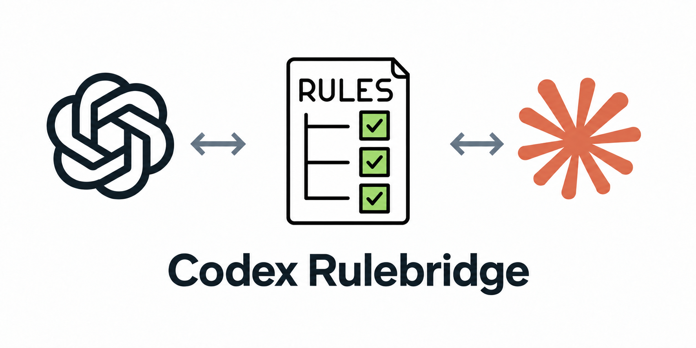

# Codex Rulebridge



**Des règles de dépôt modulaires, chargées sélectivement dans Codex.**

Organisez vos conventions dans `.agents/rules/`. Les règles globales sont chargées
au démarrage ; les règles ciblées sont chargées lorsqu’un outil local pris en
charge accède pour la première fois aux fichiers concernés. Les règles inchangées
ne sont pas réinjectées à chaque prompt.

Le projet fonctionne avec Codex seul. Si des collègues utilisent Claude Code,
activez la synchronisation bidirectionnelle avec `.claude/rules/` pour partager
les mêmes règles. Les conventions appartiennent au dépôt, pas à un modèle.

[Read in English](README.md).

La version 1.0.0 est un CLI avec un installateur shell, sans publication npm ni plugin Codex requis.

## Démonstration

https://github.com/user-attachments/assets/8dc28e7f-2b71-46eb-8207-fea8148f8cc2

[Voir la démo de 48 secondes](assets/demo.mp4). Une animation d’IDE en anglais
montre l’organisation de `.agents/rules/`, la commande `init`, la validation des
hooks et une tâche sur un composant qui charge sa règle frontend. La règle backend
reste en attente. Le partage Claude via `sync` apparaît à la fin comme une option.

L’IDE, l’indicateur de contexte et la réponse Codex sont illustratifs. Le script
vérifie le vrai CLI et des événements de hooks simulés ; les tests Codex réels sont
décrits dans la [validation en conditions réelles](docs/live-validation.md).
La démonstration correspond à la version 1.0.0.

## Démarrage rapide

Prérequis : Node.js 22+, Git et une version de Codex prenant en charge les hooks de
commande avec `additionalContext`. Utilisez macOS, Linux ou **Windows via WSL**.
L’installation et l’exécution des hooks en natif sous Windows, depuis PowerShell
ou l’invite de commandes, ne sont pas encore prises en charge.

Installation en une commande :

```sh
curl -fsSL https://raw.githubusercontent.com/Effeilo/codex-rulebridge/main/install.sh | bash
```

L’installateur nécessite Bash, Node.js 22+ et Git, ainsi que `curl` pour le
téléchargement en une commande. Il installe l’outil dans
`~/.local/share/codex-rulebridge`, crée un lien vers la commande dans `~/.local/bin`
et ajoute un bloc délimité de configuration du PATH à votre profil Bash ou Zsh.
Il sauvegarde le profil existant avant de le modifier. Ni installation npm ni
`sudo` ne sont nécessaires. Ouvrez un nouveau terminal ou chargez le profil indiqué
par l’installateur, puis exécutez :

```sh
cd /chemin/vers/votre-depot-git
codex-rulebridge init
```

**Disponible dès maintenant depuis cette copie locale du dépôt :**

```sh
bash install.sh --local .
```

Exécutez cette commande depuis le dépôt Rulebridge. Elle utilise le même
installateur, sans clonage ni requête réseau. Aucun des deux modes d’installation
ne configure automatiquement vos dépôts de travail : exécutez `init` dans chaque
dépôt que vous souhaitez configurer.

Options de l’installateur :

```sh
bash install.sh --local . --profile /chemin/vers/votre/shellrc
bash install.sh --local . --prefix /vos/outils --no-profile
```

Avec `--no-profile`, ajoutez vous-même `<prefix>/bin` à votre PATH ou utilisez le
chemin complet de la commande. Les chemins d’installation ou de profil contenant
des liens symboliques et les commandes existantes en conflit sont refusés plutôt
que remplacés. Node.js reste nécessaire à l’exécution.

Pour mettre à jour l’outil, relancez l’installation, puis exécutez
`codex-rulebridge init` dans chaque dépôt configuré afin de mettre à jour ses hooks
embarqués. Les fichiers d’installation modifiés localement ne sont pas écrasés.
Pour utiliser un tag publié, utilisez l’URL du script brut correspondant et
transmettez `RULEBRIDGE_REF=<tag>` à Bash. La branche clonée par défaut est `main`.

Pour désinstaller l’outil, supprimez le lien symbolique
`~/.local/bin/codex-rulebridge`, son dossier d’installation
`~/.local/share/codex-rulebridge` et le bloc de profil compris entre
`# >>> codex-rulebridge >>>` et `# <<< codex-rulebridge <<<`. Les règles et hooks
embarqués dans les dépôts restent utilisables : la désinstallation de la commande
globale ne les supprime pas.

Vous pouvez également utiliser npm
(`npm install --global /chemin/vers/codex-rulebridge`) ou lancer directement
l’outil sans installation :

```sh
node /chemin/vers/codex-rulebridge/src/cli.mjs init --root /chemin/vers/votre-depot-git
```

Examinez les hooks générés et accordez-leur votre confiance dans Codex. Dans le CLI
Codex, utilisez `/hooks`. La configuration `.codex/` du dépôt doit également être
reconnue comme fiable. Démarrez une nouvelle session après l’initialisation.
L’initialisation d’un dépôt ne contourne pas ces autorisations et ne modifie pas
les paramètres globaux de Codex ; seul l’installateur shell modifie votre profil shell.

### Codex en mode non interactif

Après avoir approuvé le projet et les hooks dans Codex interactif, lancez
`codex exec` depuis le dépôt avec son chemin physique :

```sh
codex exec --cd "$(pwd -P)" "Votre tâche"
```

Avec Codex CLI 0.157.1 sur macOS, un chemin `--cd` passant par un lien symbolique
(par exemple `/tmp/...` au lieu de `/private/tmp/...`) empêchait le chargement des
hooks du projet lors de nos tests réels. Utilisez `pwd -P` depuis le dépôt pour
éviter cet écart. Conservez la configuration utilisateur normale : l’option
`--ignore-user-config` empêchait également le chargement des hooks dans ce test.
`--ephemeral` fonctionne avec le chemin physique et la configuration normale.
Ce fonctionnement ne nécessite ni modification du code Rulebridge ni contournement
de la validation des hooks.

Modifiez directement `.agents/rules/` : les hooks relisent ces fichiers.
Versionnez les règles et l’intégration `.codex/` pour les nouveaux clones et
worktrees. Node.js et Git restent nécessaires à l’exécution des hooks.

## Windows via WSL

Sous Windows, utilisez une distribution Linux dans WSL et exécutez les commandes
d’installation Linux ci-dessus **dans son terminal**. Installez Node.js 22+, Git,
Bash, curl et le CLI Codex dans cette distribution WSL : les installations côté
Windows ne remplacent pas ces prérequis. Exécutez Rulebridge et Codex dans le même
environnement WSL pour que les hooks utilisent les outils et chemins Linux.

Pour une copie locale du dépôt, depuis le terminal WSL :

```sh
cd ~/projects/codex-rulebridge
bash install.sh --local .
# Ouvrez un nouveau terminal WSL ou chargez le profil indiqué par l’installateur.
cd ~/projects/votre-depot
codex-rulebridge init
```

L’installateur modifie votre **profil shell WSL**, pas le PATH Windows ni le profil
PowerShell. Il s’agit de l’installation Linux exécutée sous WSL, et non d’une prise
en charge native de Windows. WSL n’a pas encore fait l’objet de tests spécifiques
dans ce projet.

## Codex d’abord, Claude en option

```sh
codex-rulebridge init                 # Configure Codex seul sur un nouveau dépôt
codex-rulebridge explain              # Affiche les règles globales
codex-rulebridge explain --path src/ui/Button.tsx
codex-rulebridge check                # Vérifie sans écrire
```

`init` crée une règle globale de départ uniquement en l’absence de règles et
d’historique. En mode Codex seul, les règles Claude existantes restent intactes.
Pour activer le partage :

```sh
codex-rulebridge sync                 # Importe et réconcilie les deux dossiers
# Ou, dès l’initialisation :
codex-rulebridge init --claude
```

Le mode est mémorisé. Les appels suivants à `init` le conservent ; `sync` active
toujours le partage. `init --no-claude` le désactive sans supprimer les dossiers
ni l’historique de leur dernière version commune. Les installations antérieures conservent
leur mode de partage lors de la mise à jour. Aucun processus de surveillance n’est installé :
exécutez `sync` après les modifications à partager.

## Organisation du dépôt

```text
.agents/rules/
├── general.md                       # Conventions globales
└── frontend.md                      # Ciblage facultatif avec paths
.codex/
├── hooks.json                       # Autres hooks préservés
└── rulebridge/
    ├── hook.mjs
    ├── rules.mjs
    ├── paths.mjs
    ├── state.mjs
    └── manifest.json                # Mode et empreintes des fichiers
.claude/rules/                       # Créé seulement si le partage est activé
├── general.md
└── frontend.md
```

Ni `AGENTS.md` ni `CLAUDE.md` ne sont écrasés. Les fichiers Markdown sont découverts
récursivement. Leurs chemins relatifs sont identiques dans les deux dossiers.
Le code d’exécution utilise uniquement les modules natifs de Node.js, sans réseau
ni installation npm.

## Format des règles

Un fichier Markdown sans ciblage s’applique à tout le dépôt :

```markdown
# Tests

- Ajouter un test de régression lors de la correction d’un bug reproductible.
- Indiquer les vérifications exécutées.
```

Utilisez `paths` pour les conventions spécialisées :

```markdown
---
paths:
  - "src/components/**/*.{ts,tsx}"
  - "src/styles/**/*.css"
description: "Conventions frontend"
---
# Frontend

- Réutiliser les composants existants.
- Préserver l’accessibilité au clavier.
```

Le frontmatter prend en charge un sous-ensemble explicite :

- `paths` : liste indentée de chaînes entre guillemets ou tableau JSON de chaînes.
- `description` : chaîne sur une ligne ; lignes vides et commentaires sur une ligne complète autorisés.
- Motifs relatifs au dépôt avec `/`, `*`, `**`, `?`, classes de caractères et
  alternatives comme `*.{ts,tsx}`. `**/` peut aussi correspondre à zéro dossier.
- Pas de motifs négatifs, `***`, antislashs, chemins absolus ou remontées avec `..`.
- Pas d’ancres YAML, valeurs multilignes, commentaires en fin de ligne, imports
  ou champs inconnus.
- Les clés dupliquées, listes de chemins vides et règles vides sont refusées.

Les accolades sont limitées à 128 alternatives. L’ordre lexical rend le résultat
reproductible sans définir de priorité. Les règles sous forme de liens symboliques
sont refusées. Claude reçoit le Markdown et le frontmatter d’origine. Rulebridge
ne promet pas une équivalence complète avec tous les motifs acceptés par Claude.

## Quand Codex charge les règles

| Événement | Comportement |
| --- | --- |
| `SessionStart` | Charge les règles globales ; restaure les portées déjà actives après reprise ou compaction |
| `UserPromptSubmit` | Actualise les règles globales et actives qui ont changé |
| `SubagentStart` | Charge les règles globales dans le contexte du nouvel agent |
| `PreToolUse` | Sélectionne les règles selon les fichiers et charge celles qui manquent ou ont changé |
| `PostCompact` | Efface les empreintes de livraison pour permettre le rechargement |
| `SessionEnd` | Supprime le cache temporaire de ce contexte |

Le premier appel d’outil concerné est **suspendu**. Codex reçoit les instructions
et un message lui demandant de revoir puis réessayer son appel. Les arguments de
l’outil avaient déjà été préparés : cette suspension lui permet de les adapter.
Un nouvel appel séquentiel passe lorsque toutes les règles concernées ont été
transmises. Rulebridge ne demande aucune autorisation utilisateur pour ce nouvel essai.

Le cache distingue dépôts, sessions et identités des agents. Il conserve des noms
et empreintes de règles dans le dossier temporaire du système, sans leur contenu
ni les conversations. Les hooks relisent `.agents/rules/` à chaque événement utile.
Les modifications locales Codex ne nécessitent pas de synchronisation ; celles
de `.claude/rules/` nécessitent `sync` pour parvenir à Codex.
Le texte déjà transmis ne peut pas être retiré du contexte du modèle. Une
suppression déclenche un avis ; démarrez une nouvelle session après un changement
majeur de conventions.

### Ciblage et limites

Les chemins explicites de `apply_patch`, y compris la source et la destination
d’un renommage, les lectures simples comme `cat src/ui/Button.tsx` et les arguments
structurés courants de fichiers permettent le ciblage. Une lecture de dossier
charge par précaution les règles susceptibles de concerner ses descendants.
La sélection dépend des accès aux fichiers, pas des mots du prompt.

Les commandes shell complexes, scripts et outils inconnus chargent toutes les
règles ciblées par précaution. Privilégiez de petits appels avec des chemins
explicites pour économiser le contexte. Un parcours global comme `rg --files`
depuis la racine peut activer de nombreuses règles.

Il s’agit d’une approximation par hooks du chargement natif. La couverture dépend
du client Codex : certains outils hébergés et les commandes envoyées à un shell
déjà lancé ne déclenchent pas de nouvel événement `PreToolUse`. Des appels parallèles
peuvent partager l’état de livraison avant que le modèle ait traité le nouveau
contexte : la réévaluation de chaque action parallèle déjà préparée n’est donc pas
garantie. Le ciblage MCP utilise des noms d’arguments courants, sans connaître tous
les effets de chaque serveur sur les fichiers. Les règles guident le modèle et
ne constituent pas un système d’autorisation ou de contrôle d’accès.

Limites : 2 000 fichiers Markdown, 4 Mio de texte brut au total, 22 000 octets de
contexte rendu par règle et pour l’ensemble des règles globales, 24 000 octets par
injection. Le rendu comprend les titres et indications de portée. Un ensemble
trop volumineux est transmis en plusieurs lots, avec suspension des appels jusqu’à
livraison complète. Cela limite chaque injection, pas le contexte accumulé pendant
une longue session.

Les règles invalides provoquent une erreur explicite. Une erreur traitée par le
code `PreToolUse` renvoie un refus ; un hook qui ne démarre pas ou qu’un client
ignore ne peut pas apporter cette protection. Utilisez `check` en CI.

## Synchronisation bidirectionnelle

| Situation | Résultat de `sync` |
| --- | --- |
| Règle présente d’un seul côté | Copie au même chemin relatif de l’autre côté |
| Copies identiques | Enregistrement de leur empreinte commune |
| Une copie modifiée depuis la dernière version commune | Propagation vers la copie inchangée |
| Modifications divergentes ou différences sans historique commun | Conflit ; aucune écriture |
| Modifications identiques des deux côtés | Adoption de la nouvelle version commune |
| Suppression d’un seul côté | Restauration depuis l’autre copie |
| Suppression des deux côtés | Oubli de la règle |

Aucun dossier n’a priorité et les dates ne désignent pas de gagnant. Pour résoudre
un conflit, examinez les versions, rendez les copies identiques puis lancez `sync`.
Supprimez ou renommez une règle partagée dans les deux dossiers. Un renommage d’un
seul côté conserve l’ancienne règle et ajoute la nouvelle.

Le plan complet est validé avant écriture et le code embarqué modifié manuellement
est protégé. Une erreur disque peut cependant interrompre les écritures : il ne
s’agit pas d’une transaction du système de fichiers. N’exécutez pas plusieurs
commandes `init` ou `sync` simultanément.

## Commandes et mises à jour

| Commande | Comportement |
| --- | --- |
| `init` | Configure ou actualise Codex en conservant le mode de partage actuel |
| `init --claude` | Active le partage et importe les règles Claude existantes |
| `init --no-claude` | Configure Codex sans synchroniser les copies Claude |
| `sync` | Active et réconcilie le partage, actualise l’intégration |
| `check` | Vérifie règles et intégration ; recherche les divergences seulement si le partage est actif |
| `explain` | Affiche les règles globales |
| `explain --path <fichier>` | Affiche les règles globales et celles du fichier relatif au dépôt |
| `explain --all` | Affiche toutes les règles, indépendamment de leur portée |

Toutes les commandes acceptent `--root <chemin-dans-le-dépôt>`. Sinon, elles utilisent
le dépôt Git courant. Elles n’initialisent pas Git et retournent le code 1 en cas
d’erreur. `explain` est un aperçu sans état, pas une lecture du cache de la session.

Après mise à jour de l’outil, lancez `init` dans chaque dépôt pour actualiser le code
embarqué. Les manifestes v1/v2 passent à v3 en conservant le partage Claude.
Utilisez `init --no-claude` pour le désactiver. Les anciennes copies suivies sous
`.claude/rules/rulebridge/` migrent vers les chemins directs lorsque le partage est
actif et qu’elles n’ont pas été modifiées ; sinon, un conflit est signalé.
Examinez les modifications et approuvez les nouveaux hooks dans Codex, puis
ouvrez une nouvelle session.

## Développement et validation

```sh
npm ci
npm run check
npm test
npm pack --dry-run
```

Les tests exécutent le CLI, les hooks générés, le ciblage, l’état des sessions,
des événements de compaction simulés, les conflits et l’installateur dans des
dossiers temporaires. GitHub Actions cible Node 22/24 sur Linux/macOS. WSL suit
la méthode Linux sans avoir été testé indépendamment.

Des tests réels sur macOS avec Codex CLI 0.157.1 ont confirmé la livraison d’une
règle avant lecture du fichier concerné, l’absence d’une règle backend sans rapport,
l’absence de doublon lors du nouvel essai et une modification respectant la règle.
Voir les [détails et limites des tests](docs/live-validation.md). Les événements
simulés ne valident pas les agents secondaires, la compaction ou tous les clients
Codex en conditions réelles.

## Références

- [Hooks Codex](https://learn.chatgpt.com/docs/hooks)
- [Règles Claude Code](https://code.claude.com/docs/en/memory#organize-rules-with-clauderules)

## Licence

[MIT](LICENSE). Copyright (c) 2026 Effeilo.
